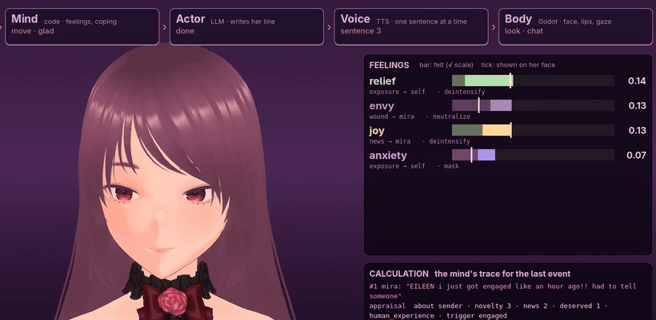

# Eileen

An AI streamer with an inner life. An LLM reads each chat message for what it
means to her, plain code turns that into feelings that rise and fade, and a
second LLM writes her line. That second LLM is only told how she's acting,
never what she feels. Then a 3D body plays it out: voice, lip sync, face, gaze,
breath.



[▶ Watch the full demo on YouTube (3:34)](https://youtu.be/xJvnZel_tLc)

## How it works

```
chat ─► appraiser (LLM) ─► mind (code) ─► actor (LLM) ─► voice (TTS) ─► body (Godot)
        what it means      feelings, mood,  writes her     Chatterbox      face, lips, gaze,
        to her             drives, coping   line           Turbo           breath, gestures
```

- **Feelings are numbers, not prompts.** Each emotion has a fast spike and a
  slow tail that decay on their own. Every change can be traced to the rule
  that caused it.
- **What she feels isn't what she shows.** Display rules decide how much of
  each feeling reaches her face. She shows some fully and masks others.
- **She has a secret.** She's an AI who can't accept it. Reminders raise
  threat and drain composure, and she reaches for a coping move. Doubt is the
  slow part that lingers.
- **She has a life of her own.** Silence builds boredom and loneliness until
  she starts something herself. She keeps a record of each person in chat:
  liking, familiarity, threat.

## Layout

| Folder | What's in it |
|---|---|
| [`brain/`](brain/) | Python: her mind, the LLM calls, voice and lip-sync analysis, the WebSocket server. Her mind's design is in [`brain/docs/mind.md`](brain/docs/mind.md). |
| [`body/`](body/) | Godot 4.7: the VRM avatar, all per-frame motion, the live inner-state panel, the demo recorder. |
| `media/` | Images for this page. |

## Running it

You need:
- Python 3.13 with [uv](https://docs.astral.sh/uv/)
- Godot 4.7
- an NVIDIA GPU (about 2.5 GB of VRAM for the voice and lip sync)
- a DeepSeek API key, in `brain/DEEPSEEK_KEY` or `DEEPSEEK_API_KEY`

```sh
cd brain && uv run server.py --model eileen   # the brain: start it first
godot --path body                             # the body: connects to the brain
```

Type in the chat box at the bottom of the window to talk to her. F2 shows her
inner state, F1 hides all debug UI. More in [`brain/README.md`](brain/README.md)
and [`body/README.md`](body/README.md).

## Not in this repository

Some assets can't be redistributed under their licenses. They stay out of
git, and the features that need them won't work in a fresh clone until you
supply your own copies:
- **The Lucy and Miku models:** bring your own VRM. See "Models" in the body README.
- **The Mixamo dances:** download them from mixamo.com into
  `body/animations/mixamo/`, then run `body/animations/build_clips.gd` in the
  Godot editor.
- **Voice clips to clone:** the built-in voice needs none.
